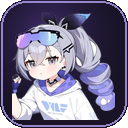

# DSH Anime Mascot · 布洛妮娅 · 伙伴

A persistent anime companion and cyberpunk pixel theme for the **DeepSeek Harness Web UI**. The plugin places Bronya in the bottom-right corner, adds four animated chimeras above the composer, and plays a six-image game-style boot splash before entering DSH.

一个常驻 DSH Web UI 的二次元陪伴插件：右下角布洛妮娅、输入栏奇美拉、六图游戏开屏、赛博朋克像素主题，以及侧边栏动态流光。

> Fan project. Not affiliated with HoYoverse, miHoYo, or DeepSeek.
> 非官方同人项目，与米哈游、HoYoverse、DeepSeek 无隶属关系。



## Features

- **Bronya companion** — fixed at the bottom-right, with idle dialogue, gaze tracking, hover reactions, pink ripples and hearts.
- **Four chimeras** — raster cut-outs of the supplied references: pink winged fairy, charcoal flower-fan cat, red fish-hugging cat and mint eyepatch cat. They walk, jump, eat, roll, stack, and emit particles on hover.
- **Six-image boot splash** — all six supplied images are shown uncropped and edge-blended, with a warp tunnel, portal rings, speed rays, glitch flashes, falling pixel Tetris blocks, a pixel-plane battle and a game HUD. It closes after the sixth image.
- **Cyberpunk composer** — animated blue-purple light flow, drifting pixel lettering and neon borders.
- **Pink rounded UI** — rounded bold font, pink text with a pink neon glow, and translucent user message bubbles with backdrop blur.
- **Themed panels** — the companion and the same background remain visible on the Plugins and Schedules pages.
- **Animated sidebar** — a translucent 24-frame layer with neon streaks, two pixel rockets, two pixel girls, a gamepad, a planet, hearts and stars.
- **Live balance HUD** — the sidebar footer shows the signed-in account balance in a cyberpunk pixel card, refreshed every 10 seconds and on window focus; click the card to refresh immediately.

## Requirements

- A DSH build that supports a local client bundle (`package.json` → `dsh.bundle` and `dsh.client`).
- The Web UI.
- A signed-in DeepSeek account for the live balance card. Signed-out users still see the card in its `NO LINK` state.

## Installation

```bash
git clone https://github.com/szjunmine/dsh-anime-mascot.git
```

Place the `dsh-anime-mascot` folder in the local bundle directory used by your DSH profile, then enable **`@local/anime-mascot`** in **Settings → Plugins**. The bundle patch is already included as `cordis.patch.yml`:

```yaml
- insert:
    - id: anime-mascot
      name: '@local/anime-mascot'
```

No build step is required. The client module is shipped as `client.js`; all artwork is embedded as base64 so the plugin has no runtime asset requests.

If your DSH version exposes an “Install local bundle” action, point it at this folder instead of copying files manually.

## Repository layout

```text
client.js          Client half: mascot, chimeras, splash, theme CSS
index.js           Host half (no-op)
cordis.patch.yml   Bundle insertion patch
package.json       Bundle manifest and DSH metadata
locale/            zh / en dictionaries
icon.png, icon.svg Plugin icons
```

## Development

1. Edit `client.js` (JSX is written with `React.createElement`; there is no bundler).
2. Reload or re-enable the bundle in DSH.
3. The client half is intentionally self-contained: CSS, sprite PNG/WebP data and locale dictionaries live in the same file.

Useful checks:

```bash
node --check client.js
python -c "import json; json.load(open('package.json', encoding='utf-8'))"
```

## Version

Current release: **1.33.0**.

See [CHANGELOG.md](CHANGELOG.md) for the release history.

## Credits

- Character art of Bronya / Silver Wolf and Honkai: Star Rail assets: **© HoYoverse / miHoYo**. Supplied by the repository owner for this fan project.
- Sidebar cosplay photograph: **米游社 @本体is眼镜**.
- Splash and background images: supplied by the repository owner.
- Built for the DeepSeek Harness Web UI.

## License

The **source code** is released under the [MIT License](LICENSE).

The character artwork, game logos, cosplay photographs and other third-party visual assets are **not** covered by the MIT License. All rights remain with their respective owners. They are included as user-supplied fan assets for personal, non-commercial use. If you are a rights holder and want an asset removed, please open an issue.

See [NOTICE.md](NOTICE.md) for the full asset notice.
